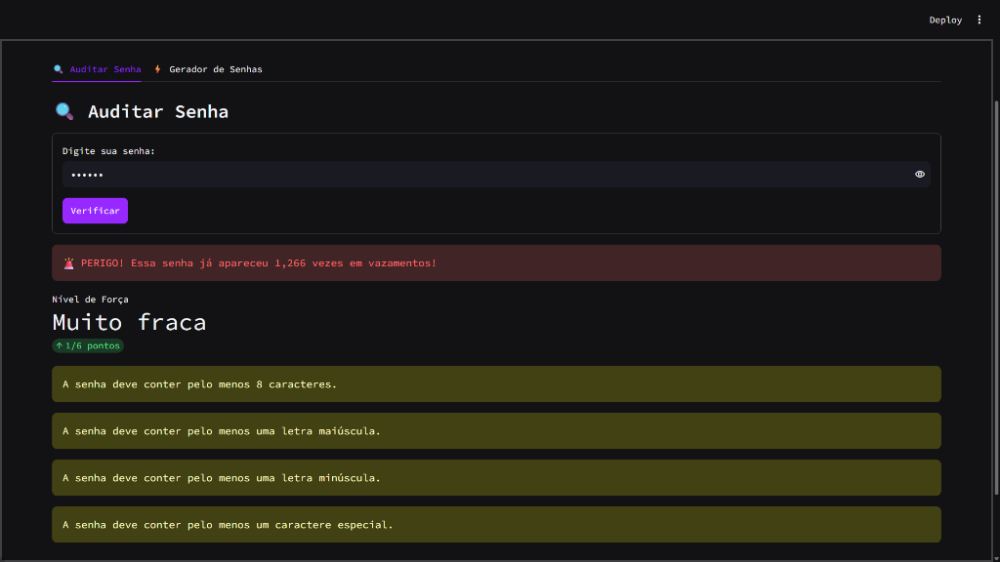
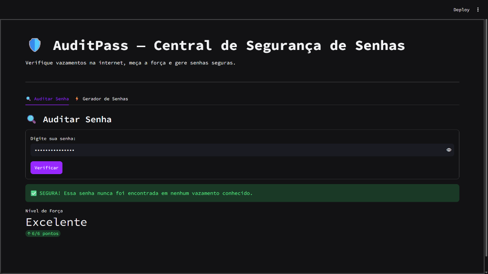
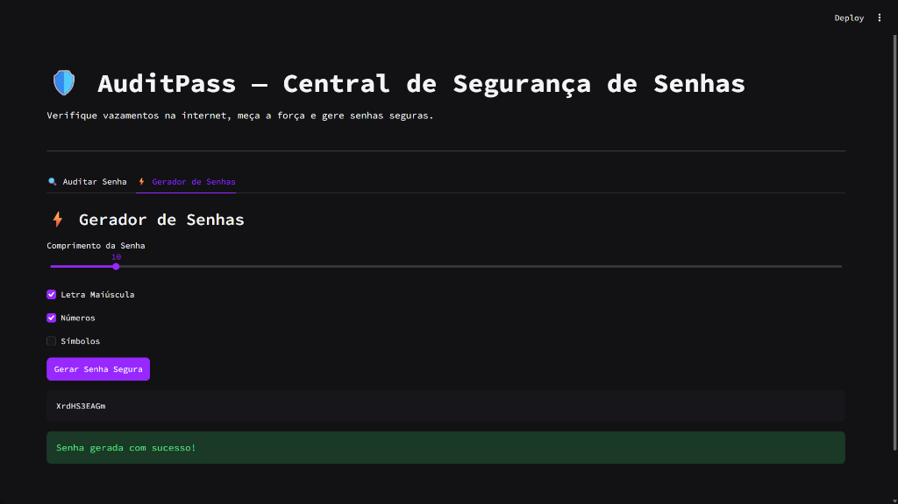

# 🛡️ AuditPass — Central de Auditoria e Geração de Senhas

O **AuditPass** é uma aplicação prática de segurança desenvolvida em Python para ajudar pessoas e empresas a testarem a força de suas senhas contra vazamentos reais na internet e gerarem senhas fortes e confiáveis.

O projeto une três frentes essenciais:
1. **Verificação de Vazamentos:** Consulta a base pública oficial da API do *Have I Been Pwned*.
2. **Privacidade Total:** Utiliza o modelo **k-Anonymity**, garantindo que a senha do usuário **nunca seja enviada para a internet**.
3. **Gerador Criptográfico:** Cria senhas aleatórias e seguras usando a biblioteca nativa `secrets` do Python.

---

## 📸 Telas do Sistema

### 1. Aba de Auditoria (Detecção de Vazamentos e Força)
O sistema calcula a pontuação da senha de 1 a 6, avisa se ela já foi exposta em vazamentos conhecidos e dá dicas diretas do que falta para melhorar:

| Senha Fraca e Vazada | Senha Forte e Segura |
| :---: | :---: |
|  |  |

---

### 2. Aba do Gerador de Senhas
Permite escolher o comprimento da senha (de 8 a 32 caracteres) e marcar quais tipos de caracteres incluir (maiúsculas, números e símbolos):

| Gerador Completo com Símbolos | Gerador Customizado |
| :---: | :---: |
|  |  |

---

## 🔒 Como Funciona a Segurança do Projeto?

### 1. Por que a senha nunca sai do seu computador? (Modelo k-Anonymity)
Muitas pessoas têm receio de testar suas senhas em sites por medo de que elas sejam salvas em servidores desconhecidos. Para resolver isso, o **AuditPass** utiliza o modelo seguro de **k-Anonymity**:

```
[ Senha digitada ] 
       │
       ▼
[ Gera Hash SHA-1 localmente ] ──► (Exemplo: 5BAA61E4C9B93F3F0682250B6CF8331B7EE68FD8)
       │
       ├───► Prefixo (apenas os 5 primeiros caracteres): "5BAA6"
       │     └─► É a ÚNICA parte enviada para a API do Have I Been Pwned via HTTPS.
       │
       └───► Sufixo (os outros 35 caracteres restantes): "1E4C9B93F3F0682250B6CF8331B7EE68FD8"
             └─► A API devolve uma lista com centenas de sufixos que começam com "5BAA6".
             └─► A conferência final é feita 100% NA MEMÓRIA do seu próprio computador.
```
> **Resultado prático:** Nem a API externa e nem ninguém na rede consegue saber qual foi a senha digitada.

---

### 2. Por que usar `secrets` em vez de `random`?
Muitos tutoriais básicos de Python ensinam a gerar senhas usando a biblioteca comum `random`. 

Porém, o `random` foi feito para jogos e simulações matemáticas: ele gera sequências que seguem fórmulas previsíveis. Para segurança de verdade, usei o módulo nativo **`secrets`**, que é recomendado oficialmente pela documentação do Python para criptografia, pois ele gera aleatoriedade real a partir do próprio sistema operacional.

---

### 3. As 6 Regras de Avaliação de Força
A senha ganha pontos conforme atende a boas práticas de segurança:
* **Pelo menos 8 caracteres** (+1 ponto)
* **Recomendação de 12 ou mais caracteres** (+1 ponto bônus)
* **Pelo menos uma letra maiúscula** (+1 ponto)
* **Pelo menos uma letra minúscula** (+1 ponto)
* **Pelo menos um número** (+1 ponto)
* **Pelo menos um caractere especial / símbolo** (+1 ponto)

A pontuação total define o nível (`Muito fraca`, `Fraca`, `Média`, `Forte` ou `Excelente`), e alertas em amarelo avisam o usuário exatamente sobre o que ele precisa adicionar para atingir a pontuação máxima.

---

## 🛠️ Tecnologias Utilizadas

* **Python 3.12+**
* **Streamlit:** Interface web moderna e responsiva com tema escuro personalizado.
* **Requests:** Comunicação segura com a API do Have I Been Pwned.
* **Hashlib:** Geração do hash SHA-1 da senha.
* **Secrets & String:** Geração criptograficamente segura de caracteres.
* **Git & GitHub:** Versionamento de código e documentação.

---

## 📂 Estrutura de Arquivos

```text
auditpass/
│
├── .streamlit/
│   └── config.toml          # Configuração visual do tema escuro e cores
│
├── assets/                  # Imagens de demonstração do sistema
│   ├── audit_leak.png
│   ├── audit_safe.png
│   ├── generator_complete.png
│   └── generator_custom.png
│
├── app.py                   # Interface gráfica com abas e formulários (Streamlit)
├── checker.py               # Consulta de vazamentos na API com k-Anonymity
├── generator.py             # Lógica de geração de senhas seguras (secrets)
├── validator.py             # Lógica de cálculo de força e dicas de melhoria
├── requirements.txt         # Bibliotecas necessárias para rodar o projeto
├── .gitignore               # Arquivos ignorados pelo Git (.venv, caches)
└── README.md                # Documentação do projeto
```

---

## ⚙️ Como Executar o Projeto Localmente

1. **Clone o repositório:**
   ```bash
   git clone https://github.com/codes-by-matheus/auditpass.git
   ```

2. **Acesse a pasta do projeto:**
   ```bash
   cd auditpass
   ```

3. **Crie e ative o ambiente virtual:**
   ```powershell
   python -m venv .venv
   .\.venv\Scripts\Activate.ps1
   ```

4. **Instale as dependências:**
   ```bash
   pip install -r requirements.txt
   ```

5. **Execute o aplicativo:**
   ```bash
   streamlit run app.py
   ```

---

## 👨‍💻 Autor

Desenvolvido por **Matheus da Silva**  
- GitHub: [codes-by-matheus](https://github.com/codes-by-matheus)

- LinkedIn: [Matheus da Silva](https://www.linkedin.com/in/matheusdasilvabarbosa/)